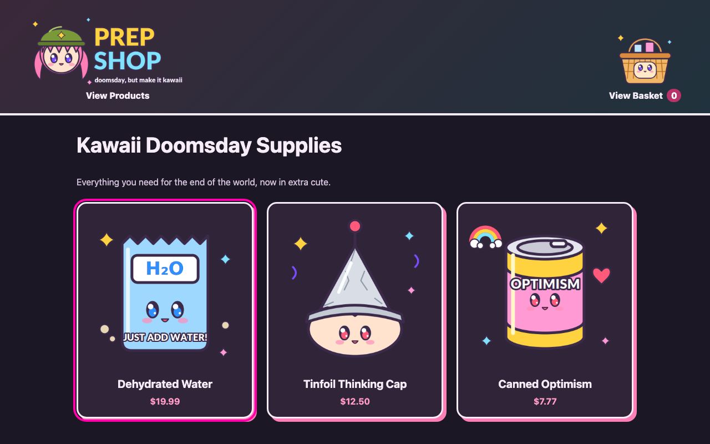
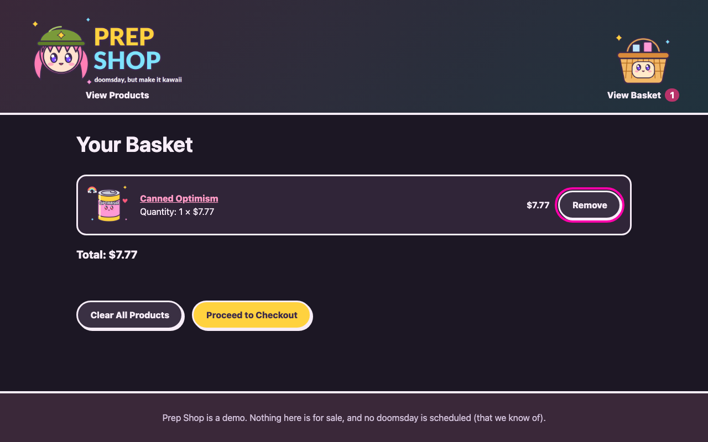
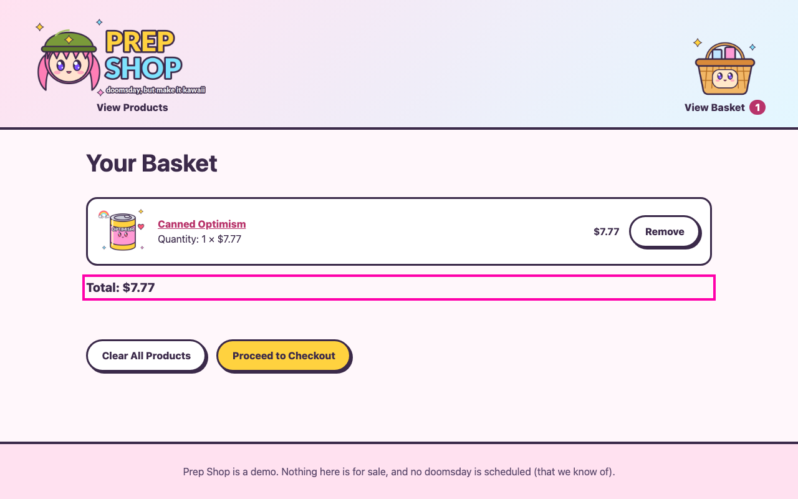
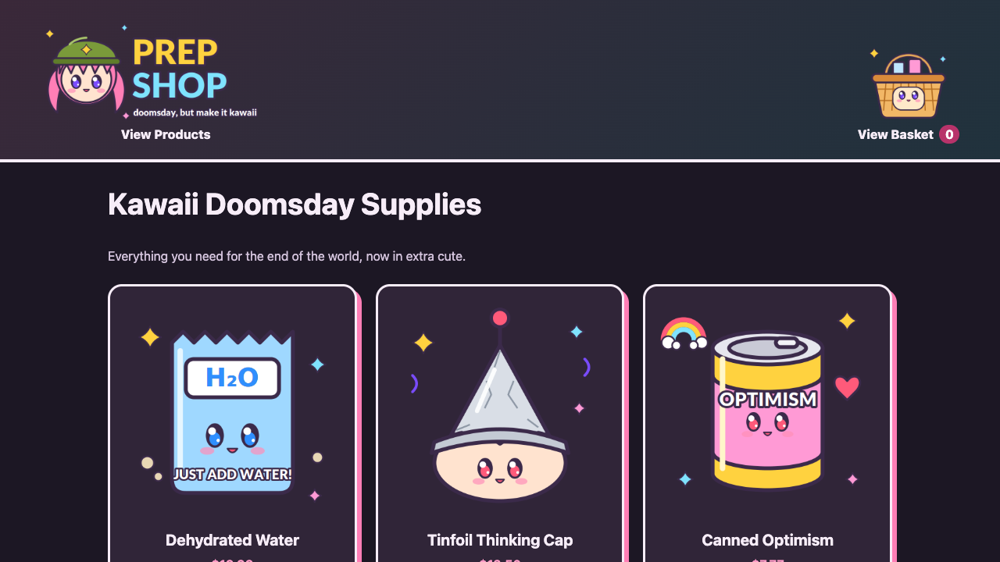
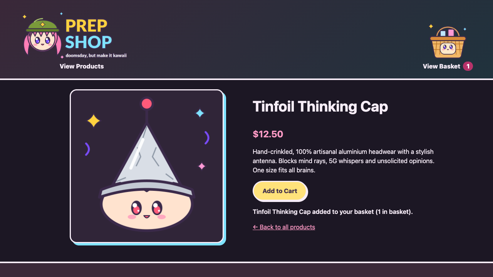
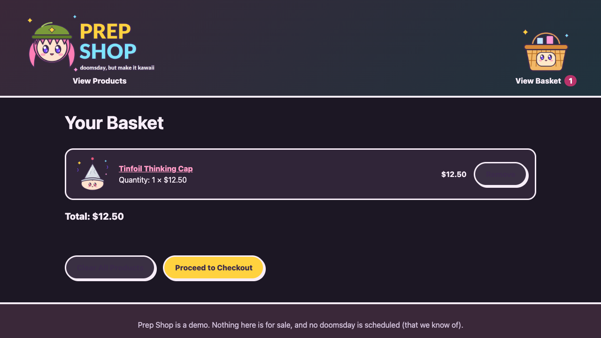
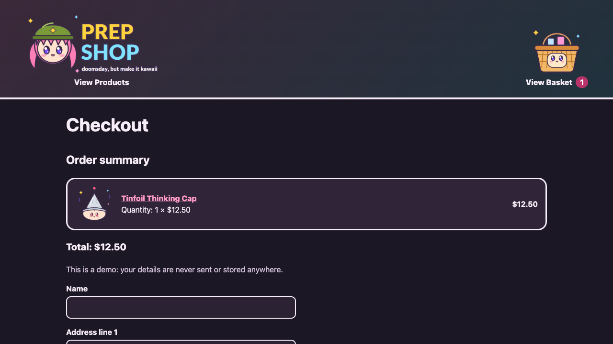
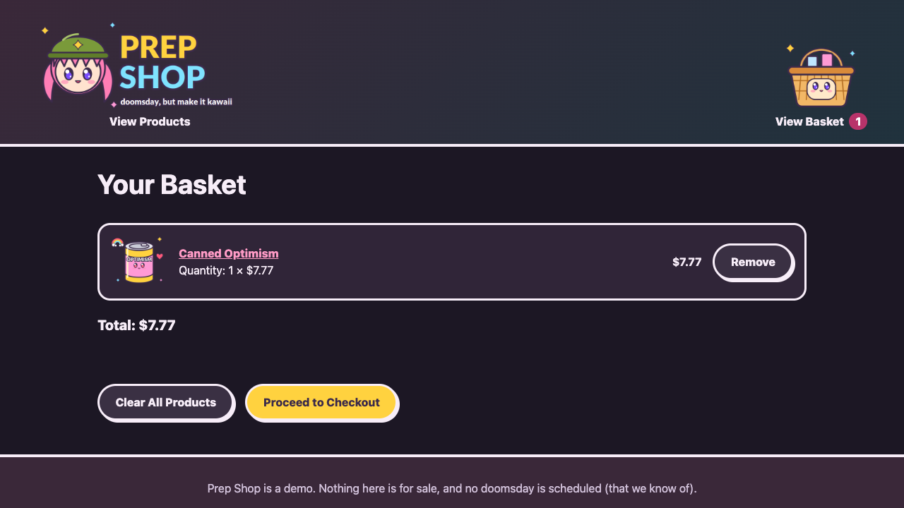
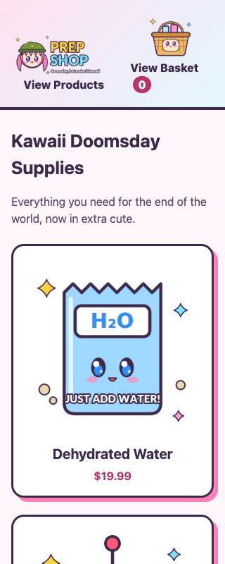
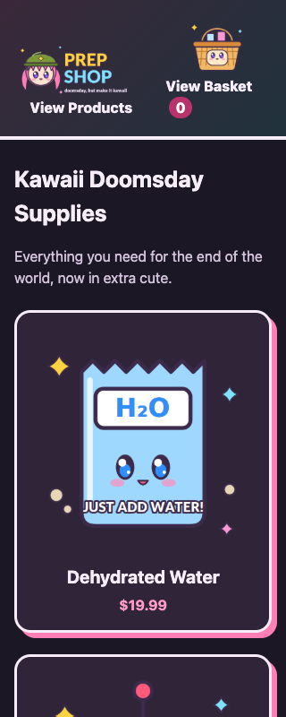

# Test report – Ticket #5: Add dark mode to shop

| Item | Value |
| --- | --- |
| Ticket | [#5](https://basic-scrum-board.vercel.app/api/tickets/5) |
| Ticket status | todo |
| Ticket last updated | 2026-10-24T18:39:20.344Z |
| Verdict | **✅ PASSED** |

## 1. Summary

- All acceptance criteria passed, all automated scenarios passed and no findings are open.

| Area | Passed | Passed with issues | Failed | Not covered / skipped | Total |
| --- | --- | --- | --- | --- | --- |
| Acceptance criteria | 2 | 0 | 0 | 0 | 2 |
| Automated scenarios – this ticket | 3 | 0 | 0 | 0 | 3 |
| Automated scenarios – regression | 9 | 0 | 0 | 0 | 9 |
| Exploratory sessions | 2 | 0 | 0 | 0 | 2 |

| Findings | critical | high | medium | low |
| --- | --- | --- | --- | --- |
| Open | 0 | 0 | 0 | 0 |
| Fixed | 0 | 0 | 1 | 0 |
| Accepted | 0 | 0 | 0 | 0 |

## 2. Goal and scope

**Goal:** Shoppers see a dark appearance when their device prefers it, while the existing light appearance and shop functionality remain unchanged.

**Affected areas:**

- README.md
- style.css
- tests/e2e/features/tickets/ticket-5-add-dark-mode-to-shop.feature
- tests/e2e/steps/dark-mode.steps.js

**Out of scope:**

- A manual theme toggle or saved theme preference
- Changes to shop content, products, basket, or checkout behavior

## 3. Clarifications and decisions

| ID | Topic | Decision | Source | Evidence |
| --- | --- | --- | --- | --- |
| D1 | Dark mode activation | Automatically follow the device's dark color-scheme preference; do not add a manual toggle. | 🙋 Asked | Asked how shoppers should activate dark mode; user selected automatic device preference. |
| D2 | Scope of the color treatment | Apply the dark appearance across the shared shop pages while keeping the existing default/light colors intact. | 🔎 Derived | Ticket AC2 requires no changes to light mode; all shop pages share style.css, and copilot-instructions.md requires preserving existing behavior and accessibility. |

## 4. Acceptance criteria

| AC | Criterion | Risk | Automated | Exploratory | Findings | Status |
| --- | --- | --- | --- | --- | --- | --- |
| AC1 | When the device prefers dark color scheme, every shop page uses a dark appearance with readable text, surfaces, links and controls. | high | 2/2 passed | S1 | F1 (fixed) | ✅ Passed |
| AC2 | When the device prefers light color scheme or has no dark preference, the existing light appearance remains unchanged, and existing shop functionality continues to work. | high | 1/1 passed | S1, S2 | None | ✅ Passed |

## 5. Automated scenarios – this ticket

| # | Feature | Scenario | AC | Risk | Result |
| --- | --- | --- | --- | --- | --- |
| 1 | Dark appearance | The shop uses a dark appearance when my device prefers dark | AC1 | high | ✅ passed |
| 2 | Dark appearance | Secondary basket controls remain readable in dark appearance | AC1 | high | ✅ passed |
| 3 | Dark appearance | The shop keeps its light appearance and shopping still works | AC2 | high | ✅ passed |

### Proof – screenshots

#### 1. The shop uses a dark appearance when my device prefers dark – ✅ passed

#### 2. Secondary basket controls remain readable in dark appearance – ✅ passed

#### 3. The shop keeps its light appearance and shopping still works – ✅ passed

## 6. Regression – existing scenarios

| Feature file | Passed | Failed | Flaky | Skipped |
| --- | --- | --- | --- | --- |
| tests/e2e/features/baseline/checkout.feature | 4 | 0 | 0 | 0 |
| tests/e2e/features/baseline/shopping-basket.feature | 5 | 0 | 0 | 0 |

## 7. Exploratory testing sessions

### S1 – Explore the dark appearance across product, basket and checkout pages with preference, consistency, keyboard and assistive-technology checks to discover unreadable surfaces or regressions.

| Field | Value |
| --- | --- |
| Status | ✅ completed |
| Acceptance criteria | AC1, AC2 |
| Heuristics | Preferences, Consistency, Keyboard only, Assistive tech |
| Environments | Chromium 1280x720, dark color scheme |
| Findings | F1 |

**Notes:**

- Product listing, product details, basket and checkout all used the dark page, header, card and form colors.
- Keyboard focus reached the skip link, and the accessibility snapshot retained the expected page headings, links, controls and status messages.
- Adding Tinfoil Thinking Cap updated the basket count and live status; basket total was $12.50; checkout completed and cleared the basket.
- The first dark basket view showed low-contrast secondary button labels. After the fix, the labels were light on the dark button surfaces.
- No browser console errors were reported on the visited pages.

**Evidence:**

- [docs/tickets/5/screenshots/S1-01-dark-home.png](screenshots/S1-01-dark-home.png)
- [docs/tickets/5/screenshots/S1-02-dark-product.png](screenshots/S1-02-dark-product.png)
- [docs/tickets/5/screenshots/S1-03-dark-basket.png](screenshots/S1-03-dark-basket.png)
- [docs/tickets/5/screenshots/S1-04-dark-checkout.png](screenshots/S1-04-dark-checkout.png)
- [docs/tickets/5/screenshots/S1-05-dark-basket-controls-fixed.png](screenshots/S1-05-dark-basket-controls-fixed.png)

### S2 – Explore the unchanged light appearance and mobile layout with light and dark device preferences to discover unintended light-mode or narrow-screen changes.

| Field | Value |
| --- | --- |
| Status | ✅ completed |
| Acceptance criteria | AC2 |
| Heuristics | Goldilocks, Preferences, Interrupt |
| Environments | Chromium 320x800, light color scheme, Chromium 320x800, dark color scheme |
| Findings | None |

**Notes:**

- At 320px wide, the product listing remained within the viewport without visible horizontal overflow.
- The light preference retained the original pink-blue header gradient, light page background and white product cards.
- Changing the emulated preference from light to dark updated the page colors without reloading.

**Evidence:**

- [docs/tickets/5/screenshots/S2-01-light-mobile.png](screenshots/S2-01-light-mobile.png)
- [docs/tickets/5/screenshots/S2-02-dark-mobile.png](screenshots/S2-02-dark-mobile.png)

## 8. Findings

| ID | Severity | Status | AC | Session | Title |
| --- | --- | --- | --- | --- | --- |
| F1 | medium | fixed | AC1 | S1 | Secondary basket button labels lacked contrast in dark appearance |

### F1 – Secondary basket button labels lacked contrast in dark appearance

**Steps to reproduce:**

1. Set the device color scheme to dark.
2. Add a product and open the basket.
3. Inspect the Remove and Clear All Products controls.

**Expected:** Secondary button labels remain readable against their dark surfaces.

**Actual:** The secondary button text used the dark primary-button text color and was difficult to read against the dark surface.

**Resolution:** Set secondary button text to the theme ink color, which is light in dark mode and unchanged in light mode. Retested with a targeted E2E assertion and a Playwright CLI basket check; the labels are readable and the page reports no console errors.

**Evidence:** [docs/tickets/5/screenshots/S1-03-dark-basket.png](screenshots/S1-03-dark-basket.png), [docs/tickets/5/screenshots/S1-05-dark-basket-controls-fixed.png](screenshots/S1-05-dark-basket-controls-fixed.png)

## 9. Residual risks

- Not explored: Non-Chromium browser rendering and native scrollbar appearance.

## 10. Artifacts

- [docs/tickets/5/ticket.json](ticket.json)
- [docs/tickets/5/requirements.json](requirements.json)
- [docs/tickets/5/exploratory.json](exploratory.json)
- [tests/e2e/features/tickets/ticket-5-add-dark-mode-to-shop.feature](../../../tests/e2e/features/tickets/ticket-5-add-dark-mode-to-shop.feature)
- [docs/tickets/5/proof](proof)
- [docs/tickets/5/report.html](report.html)

---

_Generated by `.github/skills/test-report/scripts/generate-report.mjs`. Do not edit by hand; re-run the script instead._
